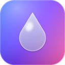

# 必应液态玻璃 · Bing Liquid Glass

给 **Edge 必应搜索页 / 新标签页** 换上一层液态玻璃：磨砂卡片、流动极光、跟随指针的高光，还可以换成自己裁剪的图片背景。

Manifest V3，无需构建，直接加载。

[**⬇ 下载最新版**](https://github.com/Enkozy/bing-liquid-glass/releases/latest) · [问题反馈](https://github.com/Enkozy/bing-liquid-glass/issues) · [隐私说明](PRIVACY.md)



---

## 功能

| 位置 | 效果 |
| --- | --- |
| 必应搜索结果 | 22px 圆角磨砂玻璃卡片、1px 高光边、内阴影，悬浮时轻微上浮 |
| 顶部栏 / 搜索框 | 磨砂玻璃条 + 玻璃胶囊，聚焦时有蓝色光环 |
| 页面背景 | 默认流动极光；也可以换成自己上传、裁剪的图片 |
| 必应首页 | 默认保留每日壁纸；选了自定义图也会一起替换 |
| 右侧栏 / 分页 / 页脚 / 搜索建议 | 同步玻璃化 |
| 深色主题 | 站点名、面包屑、栏目名、相关搜索等深色文字会转成浅色 |
| 新标签页 | 必应壁纸 / 自定义背景 + 玻璃搜索框 + 快捷网站 + 时钟 |
| 鼠标高光 | 可选，光斑跟随指针在卡片上移动 |

主题支持 **自动 / 浅色 / 深色**；模糊、通透、背景压暗、虚化都能实时调。

---

## 下载安装

1. 从 [Releases](https://github.com/Enkozy/bing-liquid-glass/releases/latest) 下载 `bing-liquid-glass-v1.1.5.zip`。
2. 解压到一个固定文件夹，例如 `D:\Extensions\bing-liquid-glass-v1.1.5`。
   > 不要直接在压缩包里运行；装好后不要删除或移动这个文件夹。
3. 打开 Edge，地址栏输入 `edge://extensions/`。
4. 打开左下角的 **开发人员模式**。
5. 点 **加载解压缩的扩展**，选择解压后的 `bing-liquid-glass-v1.1.5` 文件夹。
   文件夹里应该能直接看到 `manifest.json`，不要选它的上一层。
6. 建议点扩展栏的拼图图标，把「必应液态玻璃」固定到工具栏。
7. 打开 [cn.bing.com](https://cn.bing.com/) 搜索，或按 `Ctrl+T` 看新标签页。

> Edge 可能会提示「请关闭开发人员模式扩展」。点 **保留 / 启用**，不要点移除。重启 Edge 后如果扩展被禁用，回 `edge://extensions/` 重新打开即可。
>
> 需要 **Edge 105 或更高版本**。

---

## 使用

| 操作 | 效果 |
| --- | --- |
| 必应页面右下角 **水滴** | 打开页面内设置面板 |
| `Alt` + `G` | 打开 / 收起面板 |
| `Alt` + `Shift` + `G` | 一键开关整个效果 |
| 工具栏扩展图标 | 打开设置弹窗；「背景裁剪 / 更多设置」进入完整设置页 |
| 新标签页底部「恢复常用网站」 | 恢复浏览器里最常访问的网站（最多 10 个） |
| 新标签页「+ 添加快捷」 | 手动添加网站；悬停图标右上角 `×` 删除 |

### 自定义背景

1. 工具栏图标 → **背景裁剪 / 更多设置**（或页面面板 →「裁剪 / 设置」）。
2. **选择图片** → 拖动、滚轮或滑杆缩放 → 点 **使用这张**。
3. 用「压暗 / 提亮」「背景虚化」调整文字可读性。

支持 JPG / PNG / WebP / GIF；iPhone 的 HEIC 请先在相册导出为 JPG。图片只存在本机 `chrome.storage.local`，不会上传。

### 新标签页

- 背景：自定义图片优先，否则取必应每日壁纸（失败时回落极光）。
- 快捷网站：点「恢复常用网站」授权 `topSites` 后恢复；也可以手动添加。
- 图标使用网站真实 favicon；站点没有可访问的 favicon 时显示彩色字母。
- 右下角「换背景 / 裁剪」跳到设置页。

> **关于接管新标签页**：Edge 不允许扩展给 `edge://newtab` 注入样式，所以本扩展用 `chrome_url_overrides` 接管了新标签页。它不包含 Edge 原版的新闻流和天气。
>
> 如果不想接管：删除 `manifest.json` 里的 `"chrome_url_overrides"` 整段，在扩展页点「重新加载」，必应搜索页效果不受影响。

---

## 权限与隐私

- **storage**：保存设置和背景图，全部在本机。
- **bing.com**：注入玻璃样式、读取必应每日壁纸。
- **topSites（可选，默认不申请）**：只有点「恢复常用网站」时才弹出授权，读取最常访问的网址用于快捷方式，只在本机使用，不上传。

扩展不收集、不上传任何浏览数据；背景图只存在本机。详见 [PRIVACY.md](PRIVACY.md)。

---

## 常见问题

**新标签页没变化？**
关掉旧的新标签页，按 `Ctrl+T` 重开。若装了其他新标签页扩展，它们会冲突，只能保留一个。

**快捷网站图标是字母？**
说明那个站点根目录没有可访问的 favicon。欢迎提 [Issue](https://github.com/Enkozy/bing-liquid-glass/issues) 并附上域名。

**上传图片没反应？**
- 确认扩展版本是 1.1.5，并且在 `edge://extensions/` 点过「重新加载」；
- 选图后要等裁剪框出现，再点 **使用这张**；
- HEIC 先转 JPG；
- 设置页会显示红色错误原因。

**深色下还有黑字？**
欢迎截图提 Issue，补充对应选择器即可。

**InPrivate 窗口没有效果？**
Edge 默认禁止扩展在隐私窗口运行。到扩展「详细信息」里打开「在 InPrivate 中允许」。

**重启 Edge 后扩展被禁用？**
这是开发人员模式扩展的正常提示。回 `edge://extensions/` 重新启用；不要删除扩展文件夹。

**会不会和我原来的必应美化扩展冲突？**
会。同一页面不要装两个同类扩展；保留一个即可。

---

## 从源码加载 / 开发

仓库根目录就是扩展目录，没有构建步骤：

```bash
git clone https://github.com/Enkozy/bing-liquid-glass.git
```

然后 `edge://extensions/` → 开发人员模式 → 加载解压缩的扩展 → 选这个目录。

```
manifest.json        扩展清单
background.js        转发“打开设置页”消息
src/
  glass.css          必应页面玻璃样式
  glass.js           背景 / 指针高光 / 页面面板
  settings.js        设置与背景存储
options.html/css/js  完整设置页 + 拖拽裁剪
newtab.html/css/js   玻璃新标签页
popup.html/css/js    工具栏弹窗
icons/               16 / 32 / 48 / 128 图标
```

---

## 兼容性与声明

- 仅作用于 `bing.com`（含 `cn.bing.com`）和扩展自己的新标签页。
- 广告 / 跨域 iframe 无法美化，这是浏览器安全边界。
- 必应改版可能导致个别区域失效，需要更新选择器。
- 非微软官方产品，与 Microsoft 无关联；Bing、Edge 是 Microsoft 的商标。
- 本扩展按「现状」提供，不提供任何明示或暗示的担保。

---

## License

[MIT](LICENSE)

如果这个项目对你有帮助，欢迎点个 ⭐ Star。
